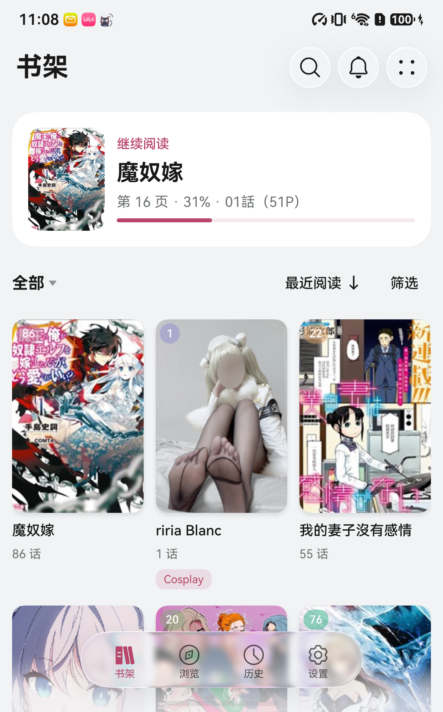
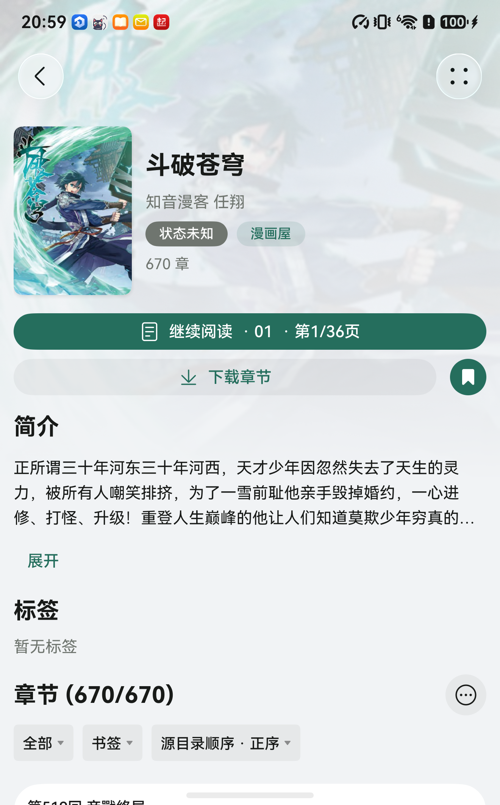
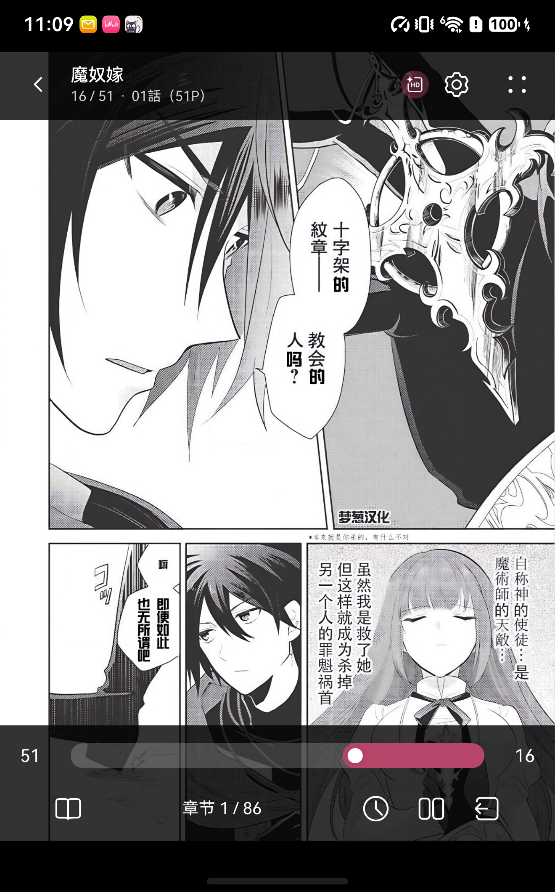
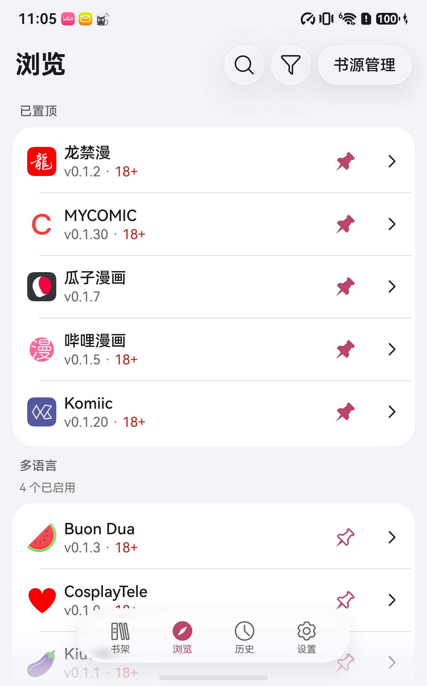
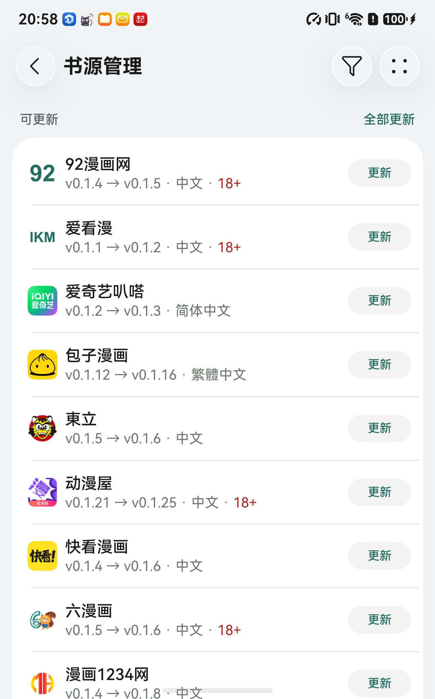
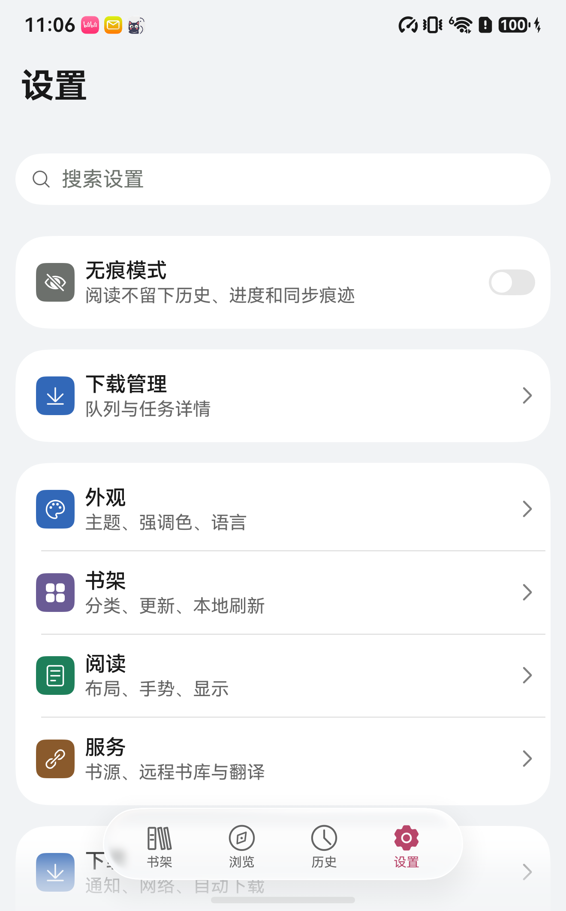

# Koma

面向 HarmonyOS 的漫画书架与阅读器。把本地漫画、私有书库和自行添加的书源放进同一个书架，保存阅读位置，接着上次的章节继续读。

## 可以做什么

- **本地阅读**：导入 CBZ / ZIP、CBR / RAR、CB7 / 7z、CBT / TAR、图片型 EPUB 和图片文件夹。
- **连接私有书库**：支持 Komga、Kavita、OPDS 和 WebDAV；具体内容格式与权限取决于服务端。
- **自行添加书源**：通过订阅地址安装、更新 `.koma` 书源，也支持本地导入。可以在源内找书，或从全局搜索进入不同来源的结果。
- **阅读与离线保存**：提供单页、双页、纵向分页和连续滚动阅读，章节下载、历史和继续阅读。
- **书架维护**：手动与智能分类、章节更新记录、跨源迁移、个人笔记，以及备份与恢复。
- **图片插件**：从独立订阅安装处理算法，查看用途、配置参数并分别启停。

更多书源与订阅说明见[书源库](https://github.com/honjow/koma-sources)。

## 截图

| 书架 | 漫画详情 | 阅读器 |
| :---: | :---: | :---: |
|  |  |  |
| **浏览** | **书源管理** | **设置** |
|  |  |  |

## 安装

最低兼容配置为 **HarmonyOS 6.1（API 23）**，当前构建面向 **arm64** 设备。

[正式版本与更新日志](https://github.com/honjow/Koma/releases/latest)

[GitHub Actions](https://github.com/honjow/Koma/actions/workflows/build.yml) 提供最新源码的构建产物。公开 HAP 未签名，需自行签名后安装；本地构建和签名方法见 [构建脚本](scripts)。

## 添加书源

Koma 不内置书源，也不包含漫画内容。书源独立维护在 **[koma-sources 书源库](https://github.com/honjow/koma-sources)**。

持续更新的订阅地址：

```text
https://github.com/honjow/koma-sources/releases/latest/download/index.json
```

1. 进入 **浏览 → 书源管理**，打开右上角四点菜单中的 **订阅地址**。
2. 点击右上角 **添加**，粘贴上面的地址并保存。可添加多个订阅；名称选填，留空时自动读取订阅提供的名称。
3. 返回“书源管理”，选择需要的书源安装，再回到“浏览”打开对应书源。浏览页按语言分组，漏斗按钮可按语言和内容分级筛选。
4. 在“书源管理”下拉检查更新；可更新书源集中显示在顶部，可分别更新或全部更新。后台检查发现更新时，“浏览”会显示缓存的更新数量角标。

订阅地址固定指向最近一次成功发布的书源库版本，无需每次更换。已添加的订阅可编辑、复制或移除；订阅提供项目主页时，也可从对应菜单打开。

也可以从[书源库发行页](https://github.com/honjow/koma-sources/releases/latest)下载单个 `.koma` 文件，再从“书源管理”右上角四点菜单选择 **本地导入**。

## 开始阅读

- **本地漫画**：从书架的导入入口选择文件或文件夹。
- **私有书库**：在设置中添加自己的服务地址与账号，再浏览书库。
- **书源漫画**：在浏览页进入已安装源，搜索或浏览作品，打开详情后阅读、加入书架或下载章节。
- **继续阅读**：从书架的“继续阅读”卡或作品详情继续；历史中可以找到最近打开的作品。

可在设置中开启自动检查书架更新、新章自动下载及自动备份，实际后台执行受系统调度和所选网络、电量条件约束。更换设备或执行恢复前，先在设置中保存备份；恢复会按确认页所示替换对应数据，并非逐项合并。

## 搜索书架

点击漫画详情中的书源名称，可查看书架里来自该源的全部作品，再输入关键词缩小范围。搜索历史会记住来源范围。

搜索框也支持书架字段查询，例如 `source:"漫画160" 王牌`、`author:尾田`、`tag:热血 -tag:恐怖`、`notes:补番 unread>0`。可用 `||` 表示“或者”、`-` 排除条件，并用括号组合；相邻条件表示同时满足。来源、标签和笔记也可写为 `src`、`genre` 和 `note`。

字段条件只查书架；普通关键词仍按漏斗里选择的范围搜索。

## 图片插件

图片插件可以通过订阅安装新的图片处理算法，例如识别并去除转载图片中的包子漫画横幅。

打开 **设置 → 阅读 → 图片插件**，或阅读器的 **阅读设置 → 图片插件**，进入同一管理页。页面按“可更新”“已安装”“可安装”分组，列出插件的名称、用途、版本和来源。

1. 点击右上角 **订阅地址 → 添加**，粘贴下面的地址。此处与 **浏览 → 书源管理 → 订阅地址** 共用，添加时自动识别订阅类型。
2. 返回插件页，在“可安装”中点击 **安装**，打开需要使用的插件开关，并确认顶部 **使用图片插件** 已开启。
3. 点击已安装插件查看说明；有配置项的插件可在此调整，修改后点标题栏 **保存**。

```text
https://github.com/honjow/koma-sources/releases/download/image-plugins-v1/index.json
```

**使用图片插件** 是总开关，可以一次暂停所有插件；关闭时，各插件自己的开关和配置会保留。

插件开启后会按自身用途处理阅读图片，无需再选择处理范围。例如，开启“去除包子漫画横幅”后，插件识别到匹配的顶部或底部横幅才会裁切，也适用于其他站点转载的同类图片；没有匹配就保留原图。反色等插件则按各自配置处理。

阅读中默认 **使用全局设置**。想仅为当前漫画暂停或开启处理，先关闭“使用全局设置”，再调整“使用图片插件”；重新打开跟随即可恢复全局设置。

下拉检查目录更新；有新版本的已安装插件显示在“可更新”中，点击 **更新**，原开关和配置会保留。订阅详情的 **自动更新** 只更新已安装插件，目录中的新插件仍需手动安装。订阅菜单可编辑名称与地址、复制地址、打开项目页或移除；订阅详情也可查看和管理其中的插件。

App 不附带具体插件或默认订阅。添加订阅只读取目录和说明，安装才下载算法，开启后才参与处理。用户主动修改插件及配置会重新准备当前图片；后台更新在下次打开阅读器时使用。

插件用于正文阅读及预载，封面不参与。章节下载和普通 CBZ 导出保留原始图片；阅读中保存或分享单张图片使用处理结果。插件及配置随备份保存。开发新算法、声明配置及发布订阅见[图片插件开发指南](https://github.com/honjow/koma-sources/blob/master/image-rules/plugins/README.md)。

## 反馈问题

App 问题请提交到 [Koma Issues](https://github.com/honjow/Koma/issues)，书源问题请提交到 [源库 Issues](https://github.com/honjow/koma-sources/issues)。说明 App/书源版本、设备型号、操作步骤和看到的错误；可在 **设置 → 高级 → 诊断日志** 标记问题发生时间，然后分享或保存本地日志。日志支持开关、级别和历史文件，并对凭据与地址脱敏；截图请先遮住个人信息，不要提供密码、Cookie 或令牌。

版本变化见[版本日志](changelog/README.md)，各次 Release 使用对应版本文件的同一份正文。

## 开发与开源

- [构建与开发脚本](scripts)
- [书源与 WASM 接口](docs/source-runtime-abi.md)
- [当前实现与已知缺口](docs/CURRENT_STATUS.md)

本项目使用的第三方组件及许可见仓内相应许可文件。

## 致谢

感谢 [LINUX DO](https://linux.do/) 社区提供的交流与分享平台。
